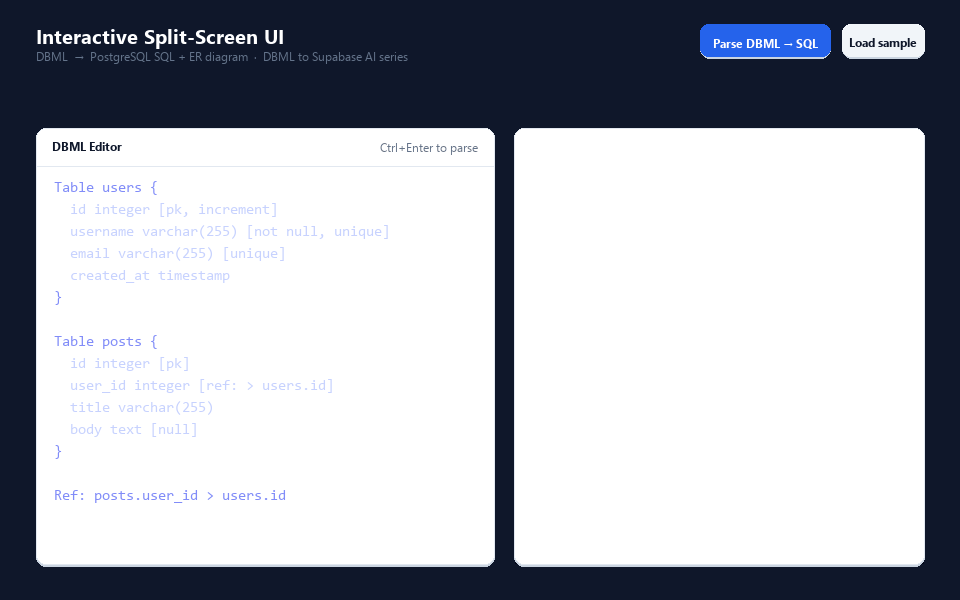
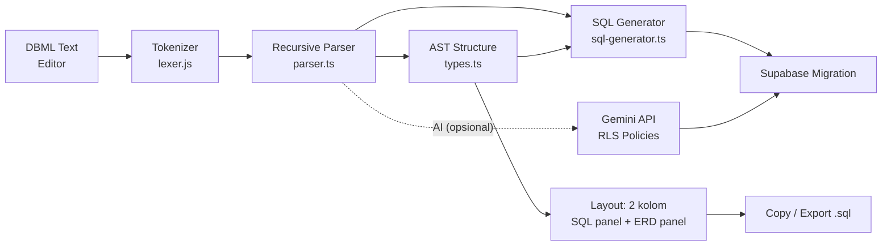

# Unit Testing, Demo & Dokumentasi

> Bagian dari seri **DBML to Supabase (AI-powered)** — pengerjaan **Day 4** yang fokus pada *code quality, error handling, demo GIF, unit testing, dan dokumentasi lengkap*.

Aplikasi Next.js dengan **UI split-screen**: editor DBML di kiri, hasil **SQL migrasi + diagram ERD** di kanan, dengan fitur **copy-to-clipboard** dan **export `.sql`**.

---

## ✨ Demo aplikasi



Alur: tulis DBML di panel kiri → klik **Parse DBML → SQL** → hasil SQL muncul di panel atas kanan, ERD Mermaid di panel bawah kanan → **Copy SQL** / **Export .sql** untuk dipakai di Supabase.

## 🧭 Arsitektur



Alur utama: **DBML → tokenizer → parser → JSON → SQL**. Gemini API (dari Day 2) melengkapi alur dengan **RLS Supplement** saat `GEMINI_API_KEY` disediakan.

### Fitur harian (rangkaian seri)

| Hari | Fokus | Repo |
|------|-------|------|
| Day 1 | Setup project + core parser DBML core | [inisiasi-core-parser](https://github.com/alwayszeed/inisiasi-core-parser) |
| Day 2 | Integrasi Gemini API untuk SQL & RLS Supabase | [Integrasi Gemini API untuk SQL & RLS](https://github.com/alwayszeed/Integrasi-Gemini-API-untuk-SQL-RLS) |
| Day 3 | UI split-screen (editor + SQL + diagram), copy & export | [Interactive Split-Screen UI](https://github.com/alwayszeed/Interactive-Split-Screen-UI) |
| Day 4 | Unit testing, demo GIF, error handling, dokumentasi | **repo ini** |

---

## 📁 Struktur project

```
.Denv
├── docs/                    # Demo GIF + script Python generator GIF
├── scripts/                 # Unit tests (tsx-based)
├── src/app/                 # Next.js App Router
│   ├── page.tsx             # UI split-screen (editor + output)
│   └── api/parse-dbml/      # POST endpoint → JSON schema
│   └── api/generate-sql-rls/# POST → Gemini migration + RLS
└── src/lib/
    ├── dbml/                # Parser DBML → JSON (tokenizer, parser, types)
    ├── gemini/              # Client Gemini API untuk SQL/RLS
    └── sql-generator.ts     # JSON → SQL & Mermaid ERD
```

---

## 🚀 Menjalankan aplikasi

```bash
npm install
npm run dev     # http://localhost:3000
npm run build   # production build
npm run lint    # eslint
```

## 🎨 DBML yang didukung

```dbml
Table users {
  id integer [pk, increment]
  username varchar(255) [not null, unique]
  email varchar(255) [unique]
  created_at timestamp
}

Table posts {
  id integer [pk]
  user_id integer [ref: > users.id]
  title varchar(255)
  body text [null]
}

Ref: posts.user_id > users.id

Enum status { active, archived }
TableGroup core { users, posts }
```

## 🛡️ Error handling

semester ini ditingkatkan pada:

- **Parser**: tidak crash di DBML rusak, mempopulasi `errors` array + pesan line-level.
- **API `/api/parse-dbml`**: response JSON yang jelas (`400` untuk body kosong, `413` untuk payload too large, `422` bila tidak ada tabel terdeteksi, `500` internal dengan logging).
- **API `/api/generate-sql-rls`**: 401 kalau API key tidak tersedia, body invalid di-reply `400`, limit model header di-truncate.
- **UI**: banner error merah dengan hint, `role="alert"` aksesibilitas, tombol copy memberi state **Copied! / Copy failed**, toast sukses, caption load sample/clear.

## 🧪 Unit testing

```bash
npm test
```

Output:

```text
Parser
  PASS  parses two tables
  ...
SQL generator
  PASS  maps pk attribute
  ...
All tests passed
```

Menguji: mem-parse 2 tabel dengan atribut (`pk`, `increment`, `not null`, `unique`), deteksi tipe, dedupe kolom `ref` + `Ref`, enum, table group, schema-qualified table, dan generator SQL/ERD.

## 🔐 Environment

Copy `.env.local.example` → `.env.local`:

```env
GEMINI_API_KEY=your-gemini-api-key
GEMINI_MODEL=gemini-1.5-flash  # optional
```

Tanpa env juga bisa: UI masih bisa parse DBML → SQL + ERD. Gemini hanya digunakan ketika API key tersedia atau di-paste di panel UI.

---

## 📌 API Quick Reference

| Endpoint                                | Method | Body                                   | Response |
|-----------------------------------------|--------|----------------------------------------|----------|
| `/api/parse-dbml`                       | POST   | `{ input: "Table users {...}" }`        | `{ tables, refs, enums, tableGroups, errors }` |
| `/api/generate-sql-rls`                 | POST   | `{ input, apiKey?, model?, parsed? }`   | `{ migrationSql, rlsSql, notes }` |

---

## 📄 Lisensi

MIT.
